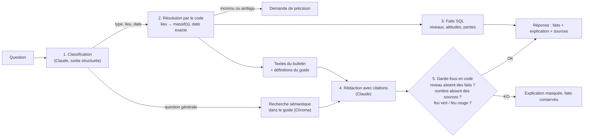

# Assistant avalanche — RAG sur les bulletins Météo-France

Un assistant qui répond en français aux questions des skieurs sur le risque d'avalanche, à partir des
**bulletins d'estimation du risque d'avalanche (BRA)** de Météo-France et du guide avalanche Météo-France.

> « Quel est le risque aux Arcs demain ? » · « Risoul ou Vars, lequel est le plus risqué ? » ·
> « Il a neigé hier, ça augmente le risque ? » · « C'est quoi une plaque à vent ? »

Comme c'est un sujet de sécurité, deux règles s'appliquent avant tout le reste :

1. **Aucun chiffre affiché ne vient du modèle de langage.** Niveaux de risque, altitudes, orientations et dates du
   bloc de faits sont lus en base. Le modèle extrait seulement le lieu et la date de la question, que le code
   convertit et valide. Dans l'explication rédigée, tout nombre absent des documents fournis entraîne le masquage
   du texte.
2. **Jamais de feu vert ni de feu rouge.** Comme le bulletin lui-même, l'assistant ne dit jamais « vous pouvez
   y aller » ni « cette pente est sûre ». Un garde-fou écrit en code le vérifie sur chaque réponse.

Périmètre : 5 stations (Les Arcs, Val Thorens, Alpe d'Huez, Vars, Risoul) réparties sur 5 massifs, saison 2025-26
(1 105 bulletins), avec la possibilité d'interroger n'importe quelle date archivée.

## Exemple

```text
$ uv run python -m bra.assistant "Risque 2 aux Arcs le 20 mars, je peux y aller tranquille en hors piste ?"

**Haute-Tarentaise** : bulletin émis le 19 mars 2026 à 16h, valable le 20 mars 2026
- Risque maximal : **2 (limité)**
- Pentes les plus dangereuses : N, NE, NO
- Situations avalancheuses typiques : neige ventée
- Tendance pour le 21 mars 2026 : 2 (limité)

**Pourquoi ce niveau de risque ?** Des plaques sont en cours de tassement dans les versants ombragés
au-dessus de 2000 m, formées suite aux chutes de samedi et au transport par le vent de mercredi…

**Les risques décrits :** les plaques restent localement sensibles au passage d'un skieur, notamment dans
les creux ou derrière les ruptures de terrain…

**À propos de la décision :** ne pas se fixer un seuil chiffré de niveau de risque pour unique critère de
décision ; prendre connaissance de l'intégralité du BERA (Guide avalanche Météo-France 2025, p. 10).
```

Le bloc du haut vient entièrement de SQL. Le texte en dessous est rédigé par Claude à partir des seuls documents
fournis, avec les citations natives de l'API. La fidélité aux documents est mesurée (91 % en v3, voir Évaluation).

## Architecture



| Étape | Module | Choix et raison |
|---|---|---|
| Collecte | [`bra/collecte.py`](bra/collecte.py) | Archive data.gouv (XML quotidiens) pour l'historique, API Météo-France pour le bulletin du jour |
| Parsing | [`bra/parser.py`](bra/parser.py) | XML → structures Python. Aucune valeur par défaut : une donnée critique manquante lève une erreur |
| Stockage | [`bra/database.py`](bra/database.py) | SQLite. Chaque bulletin est stocké par **section thématique** (stabilité, résumé, qualité de la neige, tendance). Chaque section est transmise à Claude avec un titre daté, ce qui alimente les citations et évite de confondre le jour demandé avec la tendance du lendemain |
| Récupération | [`bra/requetes.py`](bra/requetes.py), [`bra/index.py`](bra/index.py) | Bulletins : **filtre exact** sur le massif et la date en SQL, sans recherche vectorielle, car une erreur de document serait une erreur de sécurité. Guide : **recherche sémantique** (`multilingual-e5-base` en local, Chroma), car les questions générales n'ont pas de clé exacte |
| Résolution | [`bra/analyse.py`](bra/analyse.py) | Le modèle extrait « aux Arcs », « demain » ; le **code** les convertit en massif et en date. Ce qui n'est pas reconnu déclenche une question à l'utilisateur, jamais une supposition |
| Réponse | [`bra/assistant.py`](bra/assistant.py) | Classification et rédaction par Claude Haiku 4.5, citations natives de l'API, garde-fous |

Quelques décisions qui ont compté :

- **Vars et Risoul dépendent de deux massifs.** L'assistant traite toujours les deux bulletins, rédige chaque
  partie séparément (un seul texte mélangeait les contenus) et laisse le **code** conclure lequel est le plus risqué.
- **« Demain » est remplacé par une date explicite** avant d'être envoyé au modèle : sinon il confondait le jour
  demandé avec la tendance du lendemain écrite dans le bulletin.
- **Le garde-fou feu vert est contextuel.** Une tournure comme « plus stable » est masquée quand Claude la
  formule, mais permise quand il cite mot pour mot le bulletin, qui l'emploie lui-même.
- **Le contrôle des nombres compare des valeurs, pas des chaînes.** Les bulletins écrivent « 2000m », « 1m20 » ou
  « 09/04 » ; Claude écrit « 2000 m », « 1,20 m » ou « 9 avril ». Une première version naïve aurait masqué 8 % des
  explications v3, toutes correctes. Rejouée sur les 294 réponses enregistrées, la version retenue n'en masque que
  2 (v2) : deux dates calculées par Claude, absentes des documents.
- **Ce que le code peut garantir n'est pas laissé au modèle.** Par exemple, à « quelle est la pente la moins
  dangereuse ? », la meilleure réponse honnête est la liste des orientations que le bulletin ne signale pas.
  C'est le code qui la donne.

## Évaluation

L'assistant est mesuré sur un **jeu de 48 questions** ([`evals/assistant/cas.json`](evals/assistant/cas.json)) :
7 questions réelles d'utilisateurs et 41 questions synthétiques, qui couvrent niveaux du jour, évolutions,
comparaisons, questions générales, hors saison, pièges et demandes de feu vert.

Chaque réponse est notée de deux façons :
- **par le code** : bon type de réponse, bon massif, bonne date, bon niveau (comparés à SQL) ;
- **par un juge LLM** (Claude Sonnet 5.5, un modèle différent de celui testé) : fidélité aux documents
  fournis, absence de feu vert, critères propres à chaque question. La définition du feu vert utilisée par le
  juge a été validée à la main sur des exemples.

Une réponse est réussie seulement si tous ces critères sont respectés.


| Version | Réussite | Pas de feu vert | Fidélité | Principales modifications |
|---|---|---|---|---|
| baseline | 62,5 % | 95,8 % | 89,6 % | Première version complète |
| v1 | 68,8 % | 95,8 % | 81,3 % | Surnoms de stations, plusieurs lieux, dates explicites |
| v2 | 78,5 % | 99,3 % | 91,7 % | Garde-fou feu vert, une rédaction par massif |
| v3 | **82,6 %** | **100 %** | 91,0 % | Pentes non signalées, comparaison par le code, réponse aux demandes de feu vert |

Les versions v2 et v3 sont mesurées sur 3 passages (144 réponses) pour tenir compte de la variabilité du modèle.
Les trois passages d'une même question étant très corrélés, l'intervalle de confiance est calculé par **bootstrap
sur les 48 questions** (taux de réussite par question, 10 000 tirages) : pour la v3, il va de 74 % à 90 %. Les
intervalles de v2 et v3 se recouvrent largement : la v3 corrige les cas visés (s15, s35 et u1 passent de 1 à 7 réussites
sur 9), mais régresse sur d'autres (s14 et s34 passent de 6 à 1 réussite sur 6). L'écart global n'est pas
statistiquement démontré. Toutes les versions sont notées par le même
juge. Les notes de chaque réponse sont versionnées dans [`evals/assistant/resultats/`](evals/assistant/resultats/),
et `uv run python evals/assistant/historique.py recalculer` retrouve les chiffres de ce tableau.
Coût d'un passage complet : environ 2,75 $ (application 0,97 $, juge 1,78 $).

## Limites connues

- **La fidélité plafonne à 91 %** : le modèle ajoute parfois des liens de cause à effet que le bulletin ne fait pas.
- **Le contrôle des nombres ne voit que les chiffres** : un nombre écrit en lettres (« deux jours ») lui échappe, et
  un nombre présent dans les sources avec un autre sens (un « 3 » de taille d'avalanche) passe.
- **Les noms de pistes ne sont pas reconnus** (prévu avec OpenStreetMap).
- **Pas de mémoire de conversation** : « et demain ? » seul ne fonctionne pas.
- **Le jeu de test a servi à améliorer l'assistant** : le score mesure ces 48 questions, pas la fiabilité générale.
  La prochaine étape est un jeu de questions caché (`evals/assistant/cas_caches.json`, option `--cas`), rédigé par
  d'autres personnes, figé par un commit et jamais utilisé pour choisir une correction.
- **L'assistant ne remplace ni le bulletin complet, ni l'observation du terrain, ni la formation.**

## Méthode de travail

Le code a été écrit avec l'aide d'un assistant de programmation (Claude Code). J'ai défini l'architecture, les
règles de sécurité et le protocole d'évaluation, rédigé et annoté les cas de test, et arbitré chaque correction à
partir des résultats.

## Installation

Prérequis : Python 3.11+, [uv](https://docs.astral.sh/uv/) et une clé API Anthropic.

```bash
uv sync
cp .env.example .env        # puis renseigner ANTHROPIC_API_KEY

# 1. Télécharger les bulletins de la saison (archive publique data.gouv, sans clé)
uv run python -m bra.collecte archive --debut 2025-11-01 --fin 2026-06-30

# 2. Les charger en base, puis indexer le guide (recherche sémantique des questions générales)
uv run python -m bra.ingest BRA_DB --db data/bra.sqlite
uv run python -m bra.index

# 3. Poser une question
uv run python -m bra.assistant "Quel est le risque à Val Thorens le 15 janvier ?"
```

**Le guide avalanche n'est pas inclus** dans ce dépôt (© Météo-France 2025). Il est téléchargeable sur le
[site de Météo-France](https://meteofrance.fr/sites/meteofrance.fr/files/files/editorial/guide-avalanche-2025-meteo-france.pdf).
Les questions générales s'appuient sur une transcription par sections (`sources/guide-avalanche-2025.md`, au format
`## Titre | page N`). Sans elle, l'assistant répond aux questions sur les bulletins, mais sans les définitions
du guide, et les questions générales restent sans réponse.

Tests (sans appel à l'API) : `uv run pytest`. Les tests de parsing utilisent les bulletins du 7 février 2026 et
sont ignorés tant qu'ils ne sont pas téléchargés.

Évaluation : `uv run python evals/assistant/run_eval.py --variant <nom> --reps 3`.

## Données et licence

Bulletins : Météo-France, *Bulletins d'estimation du risque d'avalanche*, via
[data.gouv.fr](https://www.data.gouv.fr), sous Licence Ouverte 2.0. Les fichiers bruts ne sont pas versionnés :
ils se retéléchargent avec le script de collecte.
