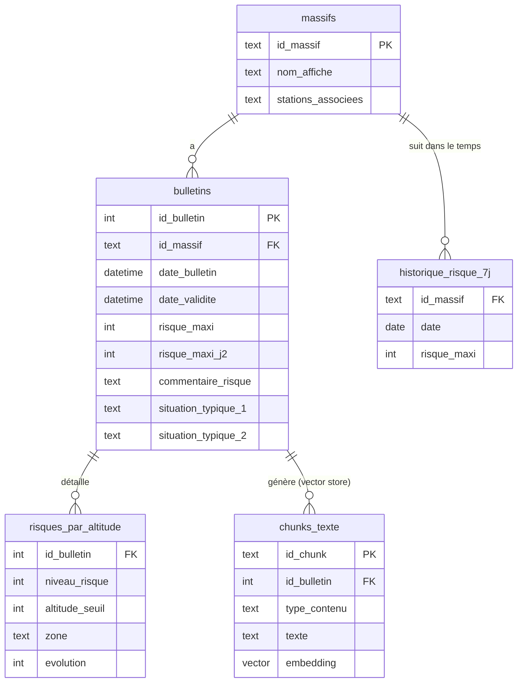
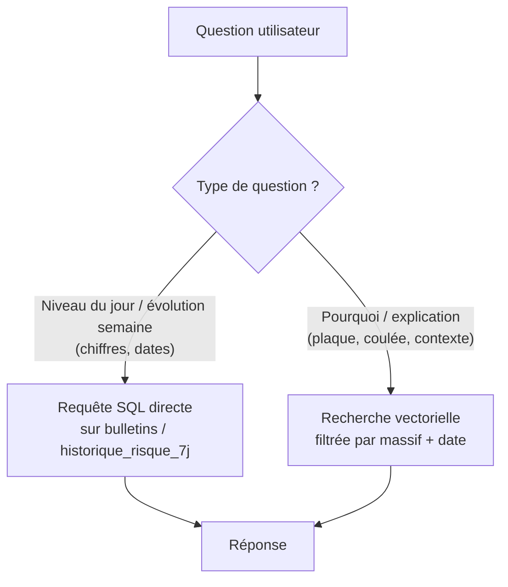

# Conception du schéma de données — Assistant BRA (avalanche)

## 0. Pourquoi ce document avant d'écrire du code

Avant de coder quoi que ce soit, il faut décider **où vit chaque donnée** et **pourquoi**. C'est la décision la plus structurante du projet : si elle est mauvaise, tu la paies pendant tout le reste du développement (requêtes lentes, réponses fausses, chunking à refaire). Ce document explique le raisonnement étape par étape, pas seulement le résultat.

---

## 1. Le problème de fond : deux natures de données, deux besoins différents

Un bulletin BRA contient en réalité **deux types d'information très différents**, et c'est la clé de toute l'architecture.

### Type A — Données structurées (chiffres, dates, catégories)
Exemples tirés du XML : `RISQUEMAXI="3"`, `DATEBULLETIN="2026-02-25T16:00:00"`, la série des 7 derniers jours de risque.

Ces données ont une caractéristique essentielle : **elles ont un sens exact et unique**. Un niveau de risque 3 est un niveau de risque 3, un point final. Pas besoin de "comprendre" quoi que ce soit pour les interroger — on veut juste les retrouver et les comparer.

**Question qu'on se pose sur ces données** : *"quelle est la valeur exacte ?"* → c'est une requête (comme dans Excel ou une base de données classique).

### Type B — Données textuelles longues (explications en langage naturel)
Exemples : le champ `STABILITE/TEXTE`, qui explique *pourquoi* le risque est à 3, avec des nuances ("un skieur peut déclencher à distance dans les grandes pentes...").

Ces données n'ont pas de structure interrogeable directement. Pour répondre à "pourquoi le risque de plaque est-il élevé aujourd'hui", il faut **chercher un passage de texte qui parle de ce sujet**, pas filtrer sur une colonne.

**Question qu'on se pose sur ces données** : *"quel passage parle de ce sujet ?"* → c'est de la recherche sémantique (RAG).

### La conséquence architecturale
> **On ne met pas ces deux types de données dans le même système.** Le Type A va dans une base de données classique (SQL). Le Type B va dans un vector store (base spécialisée dans la recherche sémantique). C'est ce qu'on appelle une architecture **hybride**.

Si tu mettais tout dans un vector store (l'erreur classique du RAG "naïf"), tu transformerais une question simple ("quel est le risque aujourd'hui ?") en recherche sémantique approximative, avec un risque de te tromper sur un chiffre — inacceptable sur un sujet de sécurité.

---

## 2. Partie 1 : la base structurée (SQL)

### 2.1 Pourquoi SQL et pas un simple fichier JSON/CSV
Tu vas vouloir faire des requêtes comme *"le risque en Vanoise a-t-il augmenté cette semaine ?"* ou *"quels massifs sont à risque 4 aujourd'hui ?"*. Une base relationnelle (SQLite pour un portfolio, pas besoin de PostgreSQL) permet ça nativement avec du SQL simple, alors qu'un fichier JSON demanderait de tout recharger en mémoire à chaque requête. Pour un projet de cette taille, **SQLite suffit largement** — un seul fichier, aucun serveur à gérer, parfait pour un portfolio.

### 2.2 Les tables

#### Table `massifs`
C'est ton référentiel géographique — la liste fixe des massifs que tu couvres.

| Colonne | Type | Exemple | Pourquoi |
|---|---|---|---|
| `id_massif` | TEXT (clé primaire) | `"QUEYRAS"` | Identifiant stable, utilisé partout ailleurs comme référence |
| `nom_affiche` | TEXT | `"Queyras"` | Ce que tu montres à l'utilisateur |
| `stations_associees` | TEXT (liste JSON) | `["Vars", "Risoul"]` | Pour répondre à "quel massif pour telle station" |

*Pourquoi une table séparée plutôt que de répéter "Queyras" partout ?* Parce que si tu dois un jour corriger un nom de massif ou ajouter une station, tu le fais à un seul endroit. C'est la règle de base des bases relationnelles : ne jamais dupliquer une information qui peut changer.

---

#### Table `bulletins`
Un enregistrement par bulletin reçu (un massif + une date = un bulletin).

| Colonne | Type | Exemple | Pourquoi |
|---|---|---|---|
| `id_bulletin` | INTEGER (clé primaire, auto) | `1042` | Identifiant technique unique |
| `id_massif` | TEXT (clé étrangère → massifs) | `"QUEYRAS"` | Lien vers le massif concerné |
| `date_bulletin` | DATETIME | `2026-02-25T16:00:00` | Le `DATEBULLETIN` du XML — LA métadonnée la plus importante du projet |
| `date_validite` | DATETIME | `2026-02-26T18:00:00` | Pour quel jour le bulletin est valable |
| `risque_maxi` | INTEGER (1 à 5) | `3` | Le champ canonique pour "quel est le risque aujourd'hui" — toujours rempli, contrairement au détail par altitude |
| `risque_maxi_j2` | INTEGER | `3` | Tendance lendemain, pour répondre à "et demain ?" |
| `commentaire_risque` | TEXT court | `"Au-dessus de 2200m..."` | Résumé en une phrase, utile pour affichage rapide sans aller chercher le texte long |
| `situation_typique_1` | TEXT (code) | `"3"` | Code `SAT1` du XML |
| `situation_typique_2` | TEXT (code) | `"4"` | Code `SAT2` du XML |

**Une clé étrangère, c'est quoi ?** C'est une colonne qui pointe vers l'identifiant d'une autre table (ici `id_massif` pointe vers `massifs.id_massif`). Ça garantit que tu ne peux pas créer un bulletin pour un massif qui n'existe pas, et ça te permet de faire des jointures (`bulletins` + `massifs` ensemble) pour afficher le nom complet du massif dans tes résultats.

**Pourquoi séparer `risque_maxi` du détail par altitude (vu la semaine dernière, le champ polymorphe) ?** Parce que `RISQUEMAXI` est *toujours* rempli et sans ambiguïté, alors que le split par altitude est parfois absent. En le mettant en colonne dédiée et stable, toutes tes requêtes "niveau du jour" deviennent triviales et fiables, quel que soit le format du jour.

---

#### Table `risques_par_altitude`
Table séparée pour le détail optionnel (0, 1 ou 2 lignes par bulletin selon les cas vus la semaine dernière).

| Colonne | Type | Exemple |
|---|---|---|
| `id_bulletin` | INTEGER (clé étrangère → bulletins) | `1042` |
| `niveau_risque` | INTEGER | `3` |
| `altitude_seuil` | INTEGER (nullable) | `2200` |
| `zone` | TEXT | `"> 2200m"` ou `"< 2200m"` |
| `evolution` | INTEGER (nullable) | `3` |

*Pourquoi une table à part plutôt que 2 colonnes `risque1`/`risque2` dans `bulletins` ?* Parce que le nombre de zones varie (0, 1 ou 2). Avec des colonnes fixes, tu aurais des cases vides à gérer partout dans ton code. Avec une table séparée, "pas de split par altitude" = simplement aucune ligne, ce qui est plus propre et plus facile à interroger ("donne-moi tous les bulletins qui ont un split par altitude" devient une simple requête).

---

#### Table `historique_risque_7j`
Une ligne par jour et par massif, alimentée par le bloc `BSH/RISQUES` du XML. C'est la table qui répond à ta question cible "évolution sur la semaine".

| Colonne | Type | Exemple |
|---|---|---|
| `id_massif` | TEXT (clé étrangère) | `"QUEYRAS"` |
| `date` | DATE | `2026-02-24` |
| `risque_maxi` | INTEGER | `3` |

*Pourquoi une table séparée de `bulletins`, alors que l'info vient du même fichier XML ?* Parce que chaque bulletin republie 7 jours d'historique — donc les mêmes dates apparaissent dans plusieurs bulletins successifs (le bulletin du 25/02 republie la valeur du 24/02, celui du 26/02 la republiera aussi). Si tu veux la série longue et propre "risque du massif X jour par jour sur toute la saison", tu ne veux pas 7 doublons par jour. Cette table dédiée, avec `(id_massif, date)` comme identifiant unique, te permet d'insérer "si la ligne existe déjà, ne rien faire" (opération dite *upsert*) et d'obtenir une série continue propre, indépendamment du re-listage dans chaque bulletin individuel.

---

### 2.3 Schéma visuel des relations



---

## 3. Partie 2 : le vector store (recherche sémantique)

### 3.1 C'est quoi exactement, pour quelqu'un qui découvre
Un **vector store** est une base spécialisée qui stocke du texte sous forme de **vecteurs numériques** (des listes de nombres, appelées *embeddings*), calculés par un modèle qui capture le *sens* du texte plutôt que les mots exacts. Deux phrases qui veulent dire la même chose avec des mots différents auront des vecteurs proches. Ça permet de chercher "par sens" plutôt que par mot-clé exact — utile pour "pourquoi le risque de coulée est élevé" même si le bulletin ne contient jamais littéralement le mot "coulée".

Pour un portfolio, des options simples et gratuites : **ChromaDB** ou **FAISS** en local (pas besoin de service payant type Pinecone).

### 3.2 Que mets-tu dedans ? (le chunking)
**Chunk = un passage de texte autonome**, assez petit pour être pertinent, assez grand pour garder son sens. Voici la découpe recommandée, un chunk par section thématique du bulletin (pas de découpe arbitraire par nombre de caractères, qui casserait le sens au milieu d'une phrase) :

| Chunk | Source XML | Contenu |
|---|---|---|
| Stabilité du manteau | `STABILITE/TEXTE` | Explication plaque/coulée — ta question cible principale |
| Qualité de la neige | `QUALITE/TEXTE` | Contexte enneigement |
| Résumé risque | `CARTOUCHERISQUE/RESUME` | Court résumé, utile si les chunks longs ne suffisent pas |
| Tendance | `CARTOUCHERISQUE/CommentaireRisqueJ2` | Évolution prévue pour le lendemain et sa raison, pour répondre à « et demain, pourquoi ? » |

### 3.3 Les métadonnées : le point le plus important de tout le document
Chaque chunk stocké dans le vector store doit être accompagné de **métadonnées** — des champs structurés attachés au texte, qui ne servent pas à la recherche sémantique mais au **filtrage avant/après recherche**.

```python
{
    "id_chunk": "QUEYRAS_202602251600_stabilite",  # heure incluse, voir §6
    "id_bulletin": 1042,           # lien vers la table SQL bulletins
    "id_massif": "QUEYRAS",
    "date_bulletin": "2026-02-25",
    "type_contenu": "stabilite",   # ou "qualite_neige", "resume", "tendance"
    "texte": "Dans les ubacs au-dessus de 2200/2300m...",
}
```

**Pourquoi c'est le point le plus important ?** Parce que sans ça, ton RAG pourrait répondre en mélangeant le bulletin du Queyras du 10 janvier avec celui du 25 février — la fidélité datée que tu as toi-même définie comme critère de succès serait impossible à garantir. La recherche sémantique doit **toujours** être combinée à un filtre `WHERE massif = X AND date = Y` posé *avant* la recherche vectorielle, jamais laissée seule. C'est ce lien avec `id_bulletin` qui relie ton vector store à ta base SQL — les deux univers communiquent par cette clé commune.

---

## 4. Comment une question utilisateur traverse le système (le routing)

C'est la pièce qui manque encore : ton système doit décider, pour chaque question, quelle partie interroger. C'est ce qu'on appelle du **routing**.



**Concrètement**, la décision peut être prise de deux façons (à choisir/tester) :
1. **Règles simples** : mots-clés ("niveau", "quel risque", "évolution" → SQL ; "pourquoi", "explique" → vecteur). Rapide à coder, bon point de départ.
2. **Un LLM qui classe la question** avant de répondre (plus robuste, plus coûteux). Amélioration possible en V2.

Pour un premier portfolio, commence par l'option 1 — c'est transparent, débogable, et déjà un vrai système hybride défendable à l'oral.

---

## 5. Comment ça répond à tes 3 questions cibles, concrètement

| Question cible | Chemin dans l'architecture |
|---|---|
| **Niveau de risque du jour** | `SELECT risque_maxi, commentaire_risque FROM bulletins WHERE id_massif=... AND date_bulletin=...` — aucun LLM nécessaire, réponse exacte garantie |
| **Évolution sur la semaine** | `SELECT date, risque_maxi FROM historique_risque_7j WHERE id_massif=... ORDER BY date` — un LLM reformule ensuite la série en phrase, mais les chiffres viennent de SQL, jamais générés |
| **Explication plaque/coulée** | Recherche vectorielle sur les chunks `type_contenu='stabilite'`, filtrée par massif+date, puis le LLM synthétise à partir des passages retrouvés (RAG classique) |

---

## 6. Écarts avec l'implémentation (`bra/database.py`)

Ajouts faits au moment de coder le parsing :
- `massifs.code_meteofrance` : l'attribut `ID` du XML (Queyras = 17…). Le chargement vérifie qu'il correspond au nom du massif, et il servira à interroger l'API par massif.
- `bulletins` : contrainte d'unicité `(id_massif, date_bulletin)`. Relancer l'ingestion met à jour le bulletin (cas d'un amendement) sans créer de doublon.
- Table `pentes_exposees` (`id_bulletin`, `orientation` parmi N/NE/E/SE/S/SW/W/NW, `exposee` 0/1) et colonne `bulletins.commentaire_pentes` (ex. « Altitude + crêtes ») : les orientations les plus exposées viennent de la balise `PENTE`. C'est une donnée exacte, donc elle est lue en SQL, jamais générée. Aucune ligne signifie que la balise était absente, pas qu'aucune pente n'est exposée.
- `chunks_texte` existe aussi comme table SQLite, où les chunks attendent l'indexation. L'étape Chroma lira cette table et calculera les embeddings.
- Les requêtes par date filtrent sur `date(date_validite)` : le bulletin émis le 07/02 à 16h répond aux questions sur le 08/02.
- Observation sur les données réelles : des massifs voisins ont des textes très proches, voire identiques (même résumé pour Queyras et Embrunais le 07/02). Filtrer par métadonnées avant la recherche vectorielle est donc indispensable, pas seulement conseillé.

### Situations avalancheuses typiques
- Table `situations_typiques(code, nom)` : codes 1 à 6 de `SAT1` et `SAT2`. La documentation XML ne donne pas leur sens, seulement « valeur de 1 à 6 », et renvoie à un fichier de correspondance. **Correspondance confirmée sur la source Météo-France le 28/09/2026.** Elle avait d'abord été déduite de :
  - l'ordre du guide (p. 13) : 1 neige fraîche, 2 neige ventée, 3 couche fragile persistante, 4 neige humide, 5 avalanches de fond, 6 aucune situation prédominante ;
  - le bulletin exemple du guide (Capcir, 10/12/2024 : `SAT1=2`, `SAT2=5`) ;
  - les mots-clés des textes de la saison, par exemple 100 % de « humide » pour le code 4.

### Guide avalanche (`bra/guide.py`, collection `guide_avalanche`)
- Source : `sources/guide-avalanche-2025.md`, une transcription par sections du guide Météo-France avec la page de chaque section, pour pouvoir citer « Guide avalanche 2025, p. 8 ». Le tableau de l'échelle de risque est découpé en une section par niveau. L'extraction automatique du PDF mélangeait ses colonnes.
- 31 sections, dans une collection Chroma **séparée** des bulletins et sans filtre de massif ni de date. Elle sert aux questions générales.
- Le guide est © Météo-France, donc `sources/` est exclu de git.

### Vector store (`bra/index.py`)
- **Modèle :** `intfloat/multilingual-e5-base`, en local, 768 dimensions, distance cosinus. Il faut les préfixes `passage: ` pour les textes et `query: ` pour les questions. Le nom du modèle est enregistré dans la collection, et l'index refuse de s'ouvrir avec un autre modèle.
- **Chunks trop longs :** 31 chunks dépassent la limite de 512 tokens du modèle, qui les tronquerait sans rien signaler. Ils sont découpés aux paragraphes en parties d'au plus 500 tokens, avec les identifiants `<id_chunk>#1`, `#2`… Chaque partie garde les métadonnées de son chunk et indique `partie` et `nb_parties`.
- **Métadonnées :**
  - `id_massif`, `type_contenu`, `id_bulletin`, `date_bulletin` et `date_validite` ;
  - `jour_validite`, la date sous forme d'entier AAAAMMJJ, car Chroma ne sait comparer que des nombres pour filtrer sur une période ;
  - `empreinte`, un hash du texte qui permet de ne ré-encoder que les chunks modifiés.
- **Mise à jour incrémentale :** seuls les chunks nouveaux ou modifiés sont encodés, et ceux qui ont disparu de SQLite sont supprimés de l'index.
- **Distances :** e5 donne des scores très resserrés, entre environ 0,11 et 0,21 sur les essais. Un seuil de distance ne suffira donc pas à repérer une question dont la réponse n'est pas dans les bulletins.

### Assistant (`bra/assistant.py`)
Chemin d'une question :
1. **Classification** par Claude (Haiku 4.5, sortie structurée) : `bulletin`, `generale`, `ambigue` ou `hors_sujet`, avec l'intention (niveau, évolution, explication), le lieu tel qu'il est écrit et la date telle qu'elle est formulée, sans calcul.
2. **Résolution par le code** ([bra/analyse.py](../bra/analyse.py)) :
   - le lieu est cherché par correspondance exacte dans le référentiel ; s'il est inconnu, le système demande le massif ;
   - Vars et Risoul renvoient les 2 massifs, ce qui déclenche une comparaison ;
   - la date est calculée à partir du calendrier ; sans date, on prend le dernier bulletin en base.
3. **Faits lus en SQL et affichés tels quels :** niveaux, altitudes, pentes, situations typiques, tendance, et pour Vars/Risoul les différences entre les deux massifs. Aucun chiffre ne passe par le LLM.
4. **Explication rédigée par Claude** à partir des seuls textes fournis, avec citations de l'API.
   - Pour une question sur un bulletin, on lui donne les 4 sections du bulletin, trouvées par requête SQL : il n'y a donc pas d'étape de recherche qui pourrait manquer un passage.
   - Pour une question générale, on lui donne les 3 sections du guide les plus proches, trouvées par Chroma.
5. **Garde-fou :** si l'explication cite un niveau de risque absent des faits SQL, elle est masquée.

Leçon des premiers essais : les documents doivent indiquer **le jour qu'ils décrivent**. La tendance d'un bulletin valable le 12 porte sur le 13. Avec des titres qui ne donnaient que la date d'émission, Claude répondait sur le mauvais jour, et le garde-fou ne le détectait pas, puisque le niveau cité existait bien dans le bulletin.

### Cas particuliers rencontrés sur la saison 2025-26 (1 105 fichiers)
- **Plusieurs bulletins le même jour.** Il y a deux cas :
  - une rediffusion avec la même `DATEBULLETIN` : le chargement la traite comme une mise à jour et garde la dernière version ;
  - une **mise à jour le matin** lors d'un épisode exceptionnel, par exemple en Grandes-Rousses le 12/02/2026 à 10h, au risque 5. C'est un bulletin à part entière, valable le jour même. L'identifiant des chunks inclut donc l'heure d'émission, et `bulletin_du_jour` renvoie le plus récent des bulletins valables ce jour-là.
- **`-1` veut dire « non renseigné »** (Queyras, 04/12/2025 : `RISQUE1=-1`, `RISQUEMAXI=2`). Le détail par altitude est alors ignoré. Si c'est `RISQUEMAXI` qui vaut -1, le bulletin est rejeté.
- **Nom de massif mal orthographié.** « Embrunnais Parpaillon » (ID 20) apparaît jusqu'au 07/01/2026, dans le nom du fichier et dans le XML. Il est corrigé par `ALIAS_MASSIFS`, et le contrôle sur l'ID Météo-France s'applique toujours.

## 7. Prochaine étape suggérée
Maintenant que le schéma est posé, l'étape logique est d'écrire le script de **parsing XML → remplissage des tables SQL + génération des chunks**, sur tes 4 fichiers XML déjà en main, pour valider que le schéma "tient" face à de vraies données avant de industrialiser la collecte quotidienne.
